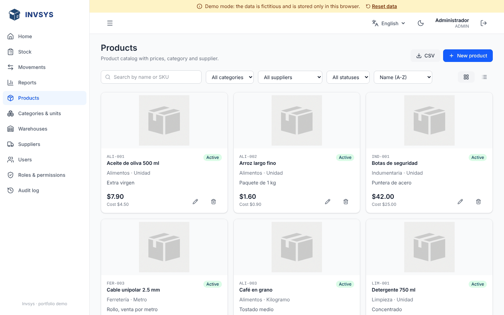
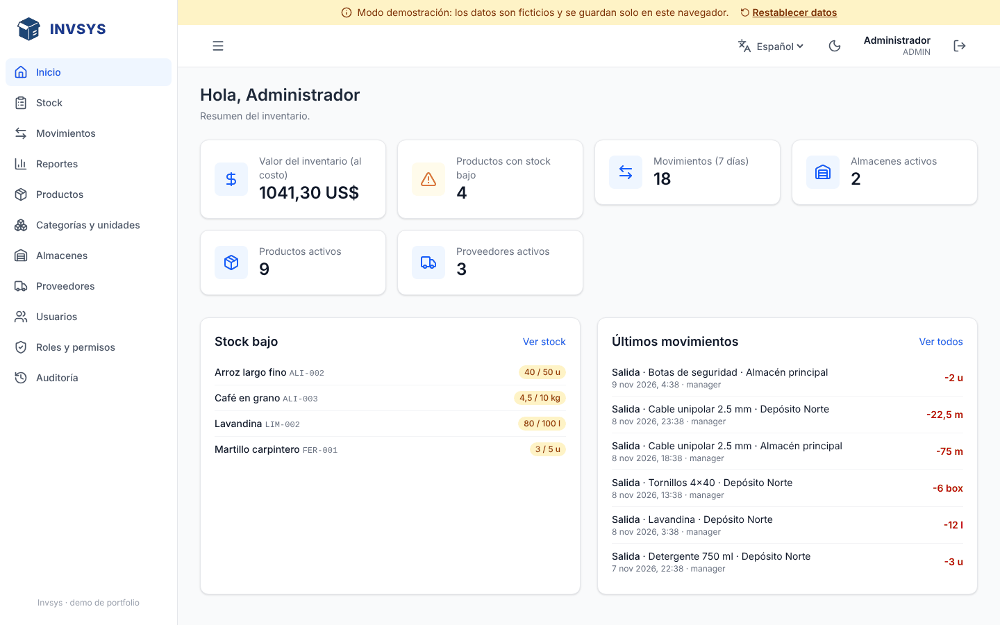
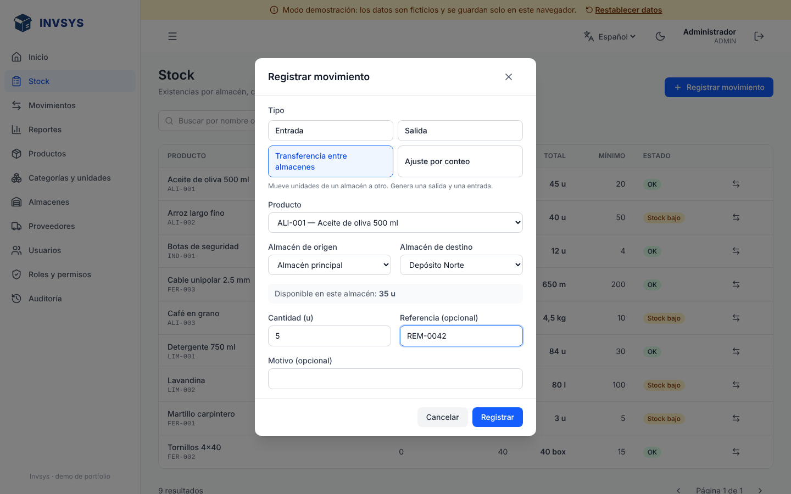
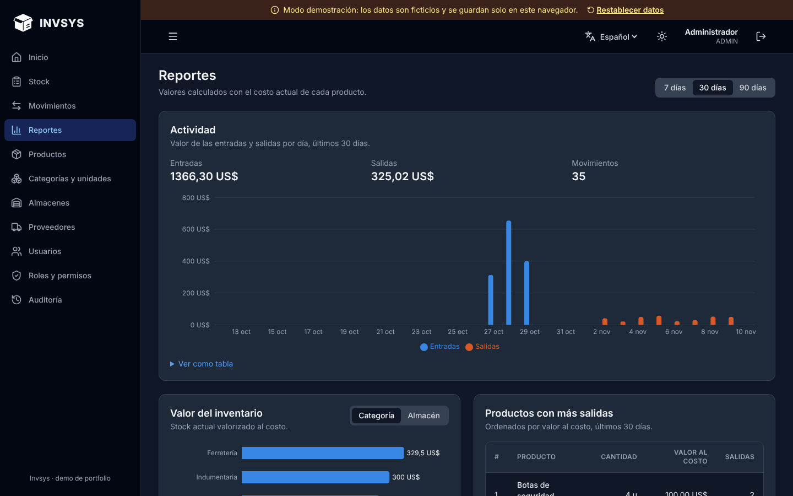
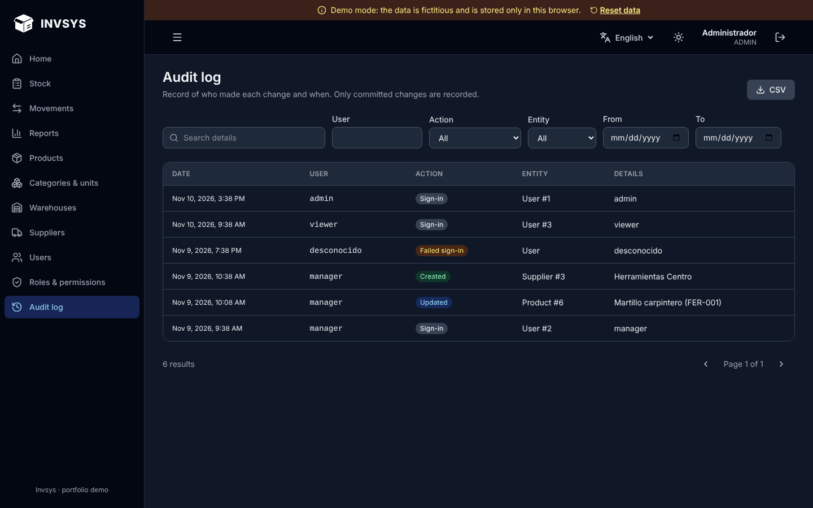
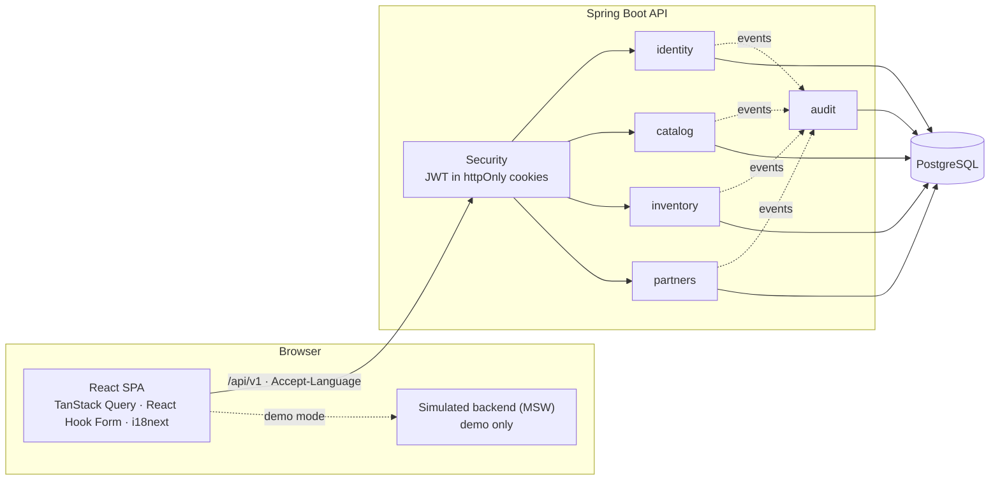

# Invsys

[](https://github.com/avacco/invsys-rmk/actions/workflows/ci.yml)

[Español](README.md) · **English**

Inventory management system: product catalog, per-warehouse stock driven by movements, suppliers, users with roles and permissions, audit log and reports.

It is a portfolio project designed as a **general, country-neutral foundation**: it implements no tax or regulatory rules, but it is built so they can be added as modules without touching the existing ones.

**Demo:** https://avacco.github.io/invsys-rmk/ — runs without a server; the data is fictitious and stored in your browser. User `admin`, password `admin1234`. Switch the language to English from the top bar.



## Features

- **Per-warehouse stock driven by movements.** Receipts, issues, stock-count adjustments and transfers. The history is immutable and the balance can never go negative, even under concurrent operations. Quantities respect each unit's decimals (1.25 kg yes, 1.5 hammers no).
- **Low-stock alerts** on the stock page and the home page.
- **Reports:** daily activity (value of receipts and issues), inventory value by category or warehouse, and top products by issues.
- **Catalog:** products with SKU, image, category, unit, supplier, cost and price; search, filters, card or table view and CSV export.
- **Users, roles and permissions** (`resource:operation`), enforced on every endpoint and reflected in the UI.
- **Audit log:** who created, changed or deleted what, every stock movement and every sign-in, including failed ones.
- **Spanish and English** in the UI and in the API error messages.
- **Light and dark mode.**

| | |
|---|---|
|  |  |
|  |  |

## Architecture



The backend is a **modular monolith**: each module (`identity`, `catalog`, `inventory`, `partners`, `audit`) owns its domain, services and endpoints, and talks to the others through events or small interfaces. A new module (purchasing, sales, invoicing, country-specific rules) plugs in by listening to events, without modifying existing ones.

Design decisions are recorded (in Spanish) in [`docs/adr/`](docs/adr):

| ADR | Decision |
|---|---|
| [0001](docs/adr/0001-monorepo-y-monolito-modular.md) | Monorepo and modular monolith |
| [0002](docs/adr/0002-demo-frontend-sin-backend.md) | Frontend demo without a backend (MSW) |
| [0003](docs/adr/0003-stock-basado-en-movimientos.md) | Stock derived from immutable movements |
| [0004](docs/adr/0004-sesion-con-cookies-httponly.md) | JWT in httpOnly cookies with rotating refresh tokens |
| [0005](docs/adr/0005-internacionalizacion.md) | UI and API internationalization |

## Stack

| Layer | Technology |
|---|---|
| Backend | Java 21, Spring Boot 3.5, Spring Security (JWT resource server), Spring Data JPA, Flyway, springdoc-openapi |
| Database | PostgreSQL 17 |
| Frontend | React 19, TypeScript, Vite, Tailwind CSS 4, TanStack Query, React Router, React Hook Form + Zod, i18next, Recharts |
| Demo | MSW (Mock Service Worker) |
| Tests | JUnit 5 + Testcontainers, Vitest + Testing Library, Playwright |
| CI | GitHub Actions |

## Running it

### Demo only (no backend)

Requires Node 20 or later.

```bash
cd frontend
npm ci
npm run dev:demo        # http://localhost:3000
```

### Full stack

Requires Docker and Node 20 or later.

```bash
docker compose up --build -d    # PostgreSQL + API at http://localhost:8080
cd frontend
npm ci
npm run dev                     # http://localhost:3000 (proxies /api to the backend)
```

Test users (`dev` profile and demo):

| User | Password | Role |
|---|---|---|
| `admin` | `admin1234` | ADMIN: full access, including the audit log |
| `manager` | `manager1234` | MANAGER: catalog, inventory and suppliers |
| `viewer` | `viewer1234` | VIEWER: read only |

Interactive API docs: http://localhost:8080/api/docs/ui

### Backend environment variables (production)

| Variable | Description |
|---|---|
| `DB_URL`, `DB_USER`, `DB_PASSWORD` | PostgreSQL connection |
| `JWT_SECRET` | JWT signing key (at least 32 characters) |
| `ADMIN_PASSWORD` | Password for the `admin` user created when the database is empty |
| `CORS_ORIGINS` | Comma-separated allowed origins (if the frontend lives on another domain) |
| `COOKIE_SECURE` | `true` (default) requires HTTPS for cookies |
| `INVSYS_CURRENCY` | ISO 4217 currency code (default `USD`) |
| `STORAGE_DIR` | Directory where images are stored |

## Tests

```bash
cd backend && ./mvnw verify          # integration tests against a real PostgreSQL (requires Docker)
cd frontend && npm test              # unit and component tests
cd frontend && npm run test:e2e      # end-to-end in a real browser, against the demo
```

- **Backend (35):** authentication and token rotation, permissions, CRUD with validation, stock movements (including 10 concurrent issues against a balance of 5), audit log, reports and bilingual messages.
- **Frontend (37):** API client, forms, inventory rules, and a test that fails if any UI text is left untranslated.
- **E2E (8):** sign-in and sign-out, the full flow of creating a product and stocking it, permission limits, language, dark mode and the demo.

CI runs all three suites on every push. The screenshots in this README are regenerated with `npm run screenshots`.

## Extending it

- **A new module** (purchasing, sales): its own package that records movements through `InventoryService` and listens to `StockMovedEvent` or `AuditEvent`.
- **Country-specific rules** (taxes, invoicing, tax IDs): a separate module; the core assumes none.
- **Another language:** a dictionary in `frontend/src/i18n` and a `messages_xx.properties` file in the backend.
- **Another image store** (S3, Cloudinary): implement the `FileStorage` interface.
- **Low-stock notifications:** `LowStockListener` already detects the event; only the channel (email, Slack…) is missing.

## License

[MIT](LICENSE) © 2026 Andres Vargas. You may use, modify and distribute this project freely, including commercially, as long as you keep the copyright notice.
