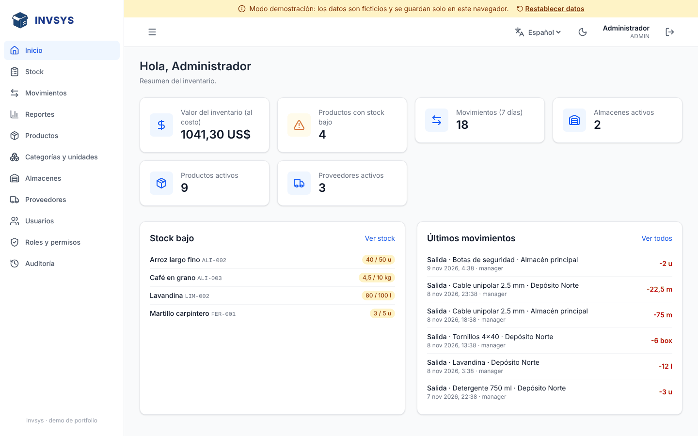
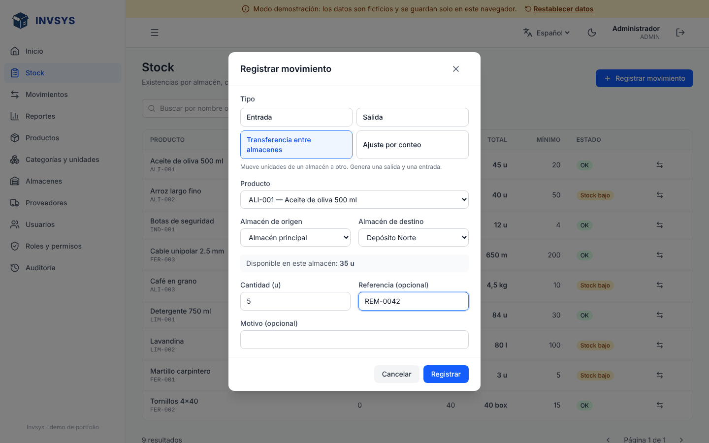
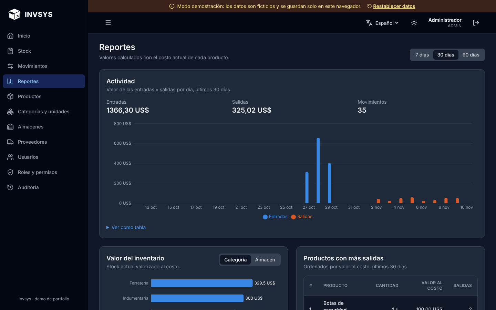
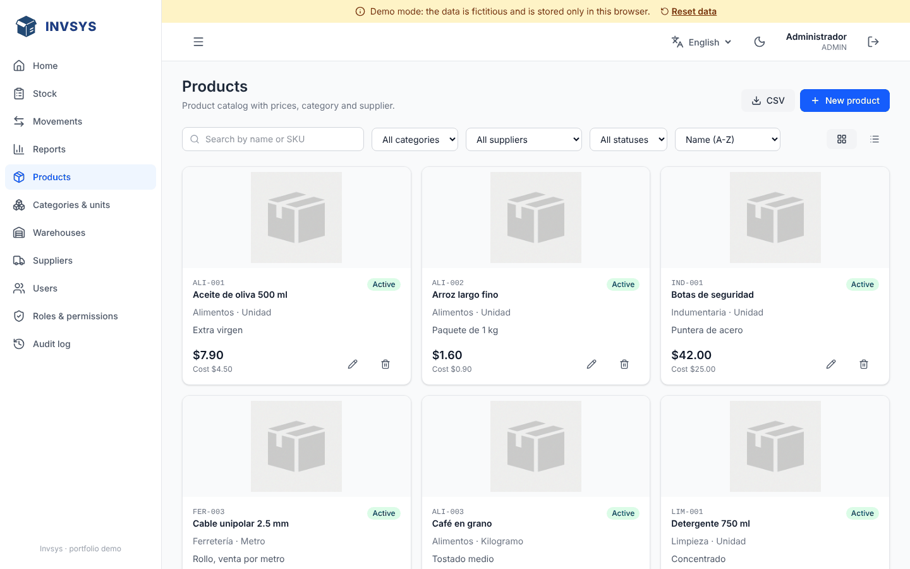
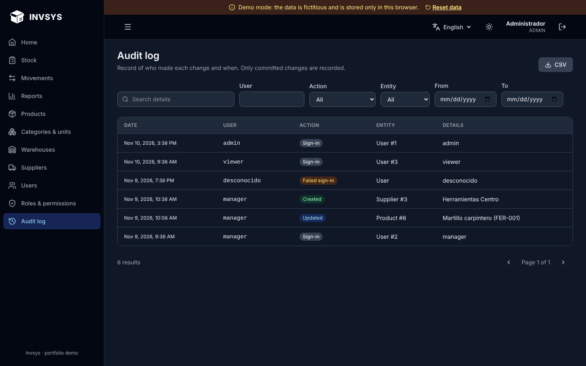
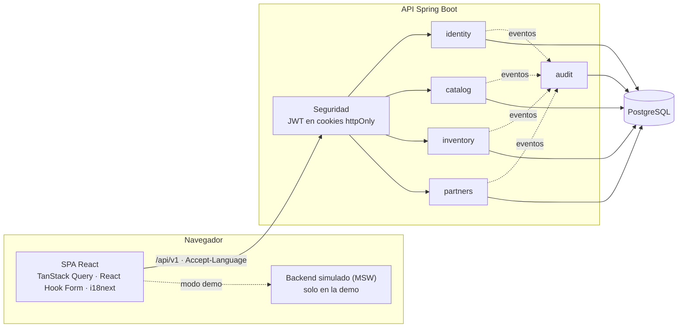

# Invsys

[](https://github.com/avacco/invsys-rmk/actions/workflows/ci.yml)

**Español** · [English](README.en.md)

Sistema de gestión de inventario: catálogo de productos, stock por almacén basado en movimientos, proveedores, usuarios con roles y permisos, auditoría y reportes.

Es un proyecto de portfolio pensado como **base general y neutral respecto del país**: no implementa reglas fiscales ni regulatorias, pero está diseñado para que puedan agregarse como módulos sin tocar los existentes.

**Demo:** https://avacco.github.io/invsys-rmk/ — funciona sin servidor; los datos son ficticios y se guardan en tu navegador. Usuario `admin`, contraseña `admin1234`.



## Funcionalidades

- **Stock por almacén basado en movimientos.** Entradas, salidas, ajustes por conteo físico y transferencias. El historial es inmutable y el saldo nunca queda negativo, ni siquiera con operaciones simultáneas. Las cantidades respetan los decimales de cada unidad (1,25 kg sí, 1,5 martillos no).
- **Alertas de stock bajo** en la pantalla de stock y en el inicio.
- **Reportes:** actividad diaria (valor de entradas y salidas), valor del inventario por categoría o almacén y productos con más salidas.
- **Catálogo:** productos con SKU, imagen, categoría, unidad, proveedor, costo y precio; búsqueda, filtros, vista de tarjetas o tabla y exportación CSV.
- **Usuarios, roles y permisos** (`recurso:operación`), aplicados en cada endpoint y reflejados en la interfaz.
- **Auditoría:** quién creó, modificó o borró cada cosa, cada movimiento de stock y cada inicio de sesión, incluidos los fallidos.
- **Español e inglés** en la interfaz y en los mensajes de error de la API.
- **Modo claro y oscuro.**

| | |
|---|---|
|  |  |
|  |  |

## Arquitectura



El backend es un **monolito modular**: cada módulo (`identity`, `catalog`, `inventory`, `partners`, `audit`) tiene su dominio, sus servicios y sus endpoints, y se comunica con los demás mediante eventos o interfaces pequeñas. Un módulo nuevo (compras, ventas, facturación, reglas de un país) se suma escuchando eventos, sin modificar los existentes.

Las decisiones de diseño están documentadas en [`docs/adr/`](docs/adr):

| ADR | Decisión |
|---|---|
| [0001](docs/adr/0001-monorepo-y-monolito-modular.md) | Monorepo y monolito modular |
| [0002](docs/adr/0002-demo-frontend-sin-backend.md) | Demo del frontend sin backend (MSW) |
| [0003](docs/adr/0003-stock-basado-en-movimientos.md) | Stock calculado a partir de movimientos inmutables |
| [0004](docs/adr/0004-sesion-con-cookies-httponly.md) | Sesión con JWT en cookies httpOnly y refresh tokens rotativos |
| [0005](docs/adr/0005-internacionalizacion.md) | Internacionalización de interfaz y API |

## Stack

| Capa | Tecnología |
|---|---|
| Backend | Java 21, Spring Boot 3.5, Spring Security (resource server JWT), Spring Data JPA, Flyway, springdoc-openapi |
| Base de datos | PostgreSQL 17 |
| Frontend | React 19, TypeScript, Vite, Tailwind CSS 4, TanStack Query, React Router, React Hook Form + Zod, i18next, Recharts |
| Demo | MSW (Mock Service Worker) |
| Tests | JUnit 5 + Testcontainers, Vitest + Testing Library, Playwright |
| CI | GitHub Actions |

## Cómo correrlo

### Solo la demo (sin backend)

Requiere Node 20 o superior.

```bash
cd frontend
npm ci
npm run dev:demo        # http://localhost:3000
```

### Completo (con backend)

Requiere Docker y Node 20 o superior.

```bash
docker compose up --build -d    # PostgreSQL + API en http://localhost:8080
cd frontend
npm ci
npm run dev                     # http://localhost:3000 (redirige /api al backend)
```

Usuarios de prueba (perfil `dev` y demo):

| Usuario | Contraseña | Rol |
|---|---|---|
| `admin` | `admin1234` | ADMIN: acceso total, incluida la auditoría |
| `manager` | `manager1234` | MANAGER: catálogo, inventario y proveedores |
| `viewer` | `viewer1234` | VIEWER: solo lectura |

Documentación interactiva de la API: http://localhost:8080/api/docs/ui

### Variables de entorno del backend (producción)

| Variable | Descripción |
|---|---|
| `DB_URL`, `DB_USER`, `DB_PASSWORD` | Conexión a PostgreSQL |
| `JWT_SECRET` | Clave para firmar los JWT (mínimo 32 caracteres) |
| `ADMIN_PASSWORD` | Contraseña del usuario `admin` que se crea si la base está vacía |
| `CORS_ORIGINS` | Orígenes permitidos, separados por coma (si el frontend está en otro dominio) |
| `COOKIE_SECURE` | `true` (por defecto) exige HTTPS para las cookies |
| `INVSYS_CURRENCY` | Código ISO 4217 de la moneda (por defecto `USD`) |
| `STORAGE_DIR` | Carpeta donde se guardan las imágenes |

## Tests

```bash
cd backend && ./mvnw verify          # integración contra PostgreSQL real (requiere Docker)
cd frontend && npm test              # unitarios y de componentes
cd frontend && npm run test:e2e      # E2E en un navegador real, contra la demo
```

- **Backend (35):** autenticación y rotación de tokens, permisos, CRUD con validaciones, movimientos de stock (incluida una prueba de 10 salidas simultáneas sobre un saldo de 5), auditoría, reportes y mensajes en dos idiomas.
- **Frontend (37):** cliente de la API, formularios, reglas del inventario y un test que falla si queda texto de la interfaz sin traducir.
- **E2E (8):** inicio y cierre de sesión, el flujo completo de crear un producto y darle stock, límites de permisos, idioma, modo oscuro y la demo.

El CI corre las tres suites en cada push. Las capturas de este README se regeneran con `npm run screenshots`.

## Estructura

```
invsys/
├── backend/                 API REST (Spring Boot)
│   └── src/main/java/com/invsys/
│       ├── identity/        usuarios, roles, permisos, autenticación
│       ├── catalog/         productos, categorías, unidades
│       ├── inventory/       almacenes, saldos, movimientos y reportes
│       ├── partners/        proveedores
│       ├── audit/           registro de auditoría
│       ├── storage/         almacenamiento de imágenes (intercambiable)
│       └── shared/          errores, paginación, idioma, configuración
├── frontend/                SPA (React)
│   ├── src/
│   │   ├── api/             cliente HTTP y tipos del contrato
│   │   ├── features/        una carpeta por pantalla
│   │   ├── i18n/            traducciones (es → en) y test de cobertura
│   │   └── mocks/           backend simulado para la demo y los tests
│   └── e2e/                 tests de Playwright
├── docs/
│   ├── adr/                 decisiones de arquitectura
│   └── screenshots/
└── docker-compose.yml       PostgreSQL + API para desarrollo
```

## Cómo extenderlo

- **Un módulo nuevo** (compras, ventas): un paquete propio que genera movimientos con `InventoryService` y escucha `StockMovedEvent` o `AuditEvent`.
- **Reglas de un país** (impuestos, facturación, identificación fiscal): un módulo aparte; el núcleo no asume ninguna.
- **Otro idioma:** un diccionario en `frontend/src/i18n` y un `messages_xx.properties` en el backend.
- **Otro almacenamiento de imágenes** (S3, Cloudinary): implementar la interfaz `FileStorage`.
- **Notificaciones de stock bajo:** `LowStockListener` ya detecta el evento; falta el canal (email, Slack…).

## Publicar la demo

La demo se publica en GitHub Pages con el workflow **Demo en GitHub Pages**, que se ejecuta a mano:

1. En el repositorio: **Settings → Pages → Source: GitHub Actions**.
2. **Actions → Demo en GitHub Pages → Run workflow.**

El sitio queda en `https://<usuario>.github.io/<repositorio>/`.
